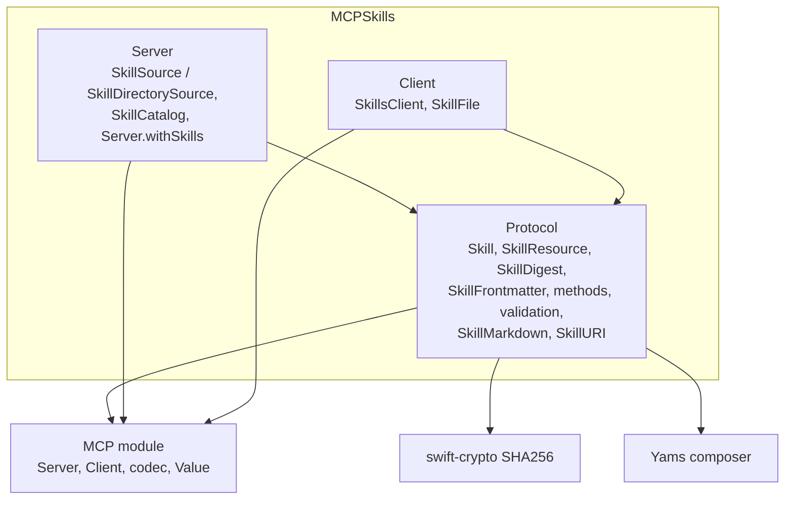
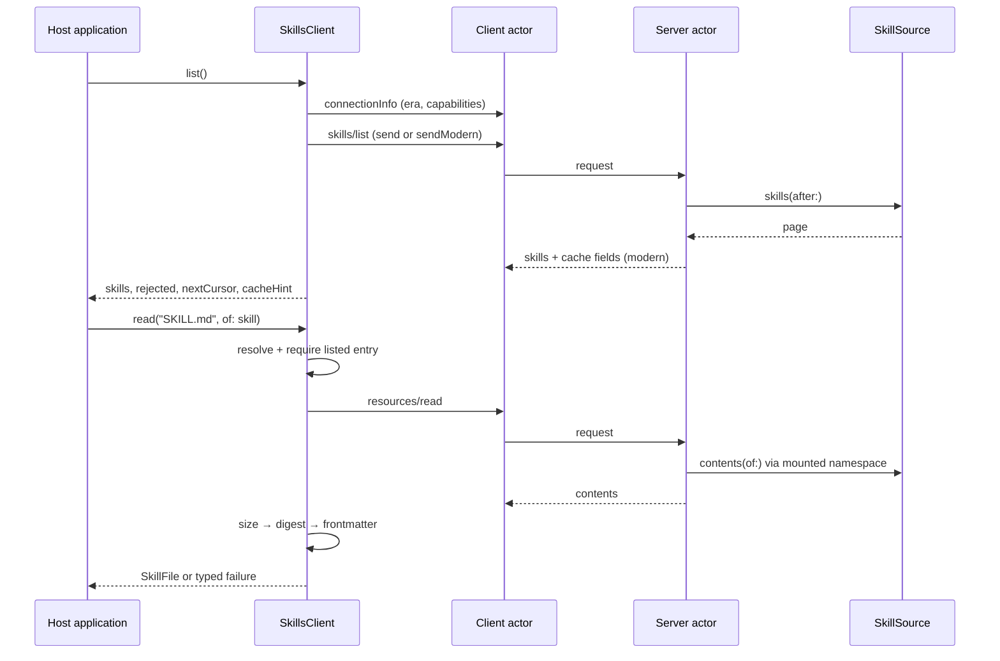

# MCPSkills Module

## Purpose and Scope

This document is the module design for the SwiftPM target `MCPSkills`. The
module implements the MCP Skills extension (`io.modelcontextprotocol/skills`,
SEP-2640) on top of the public and package contracts of the `MCP` module.

The normative source is the Skills extension beta specification
(`modelcontextprotocol/ext-skills`, `specification/beta/skills.mdx`, commit
`0daf88c`). Where SEP-2640 and the beta page differ, the beta page wins.

Parent: [repository/package master](../../DESIGN.md).

Children: none. The module is split into three directories that share one
module-internal namespace: `Protocol/`, `Server/`, and `Client/`.

## Responsibilities and Boundaries

| Owned here | Not owned here |
| --- | --- |
| Skills wire vocabulary: `Skill`, `SkillResource`, `SkillDigest`, `SkillFrontmatter`, `SkillsCapability`, and the `skills/list`, `skills/get`, and `resources/directory/read` method models | JSON-RPC framing, era negotiation, `_meta`, `resultType`, transports (owned by `MCP`) |
| Skill entry validation (URI/name agreement, naming rules, manifest completeness, digest format) | Host approval, trust, origin binding, disk caching, and consent policy (application) |
| SKILL.md frontmatter parsing (YAML 1.2 core schema subset) and field-by-field comparison | Rendering or activating a skill for a model (application) |
| Server: `SkillSource` contract, in-memory `SkillCatalog`, and `Server.withSkills(_:)` wiring | Application-owned resources outside the skills namespace |
| Client: `SkillsClient` capability gating, listing, lookup, verified reads (size, digest, frontmatter), and directory reads | Persistence of skills or verification results |

The module depends on `MCP`, `Crypto` (swift-crypto, for SHA-256 on every
supported platform), and `Yams` (YAML parsing). These dependencies are the
reason this is a separate target: the `MCP` module's dependency graph does not
change.

## Related Designs

| Design | Relationship | Contract used | Cautions |
| --- | --- | --- | --- |
| [Package master](../../DESIGN.md) | parent | package composition, era vocabulary, conformance scope | Skills scenarios use a separate referee pin |
| [MCP module](../MCP/DESIGN.md) | depends on | `Method`, `Server`, `Client`, `CapabilitySet`, `CacheHint`, `Value`, `MCPError` | only public and `package` API |
| [Server orchestration](../MCP/Server/DESIGN.md) | depends on | `withMethodHandler`, `HandlerContext.era`, package resource-namespace mounting | mounted namespaces are consulted before the application `resources/read` handler |
| [Client orchestration](../MCP/Client/DESIGN.md) | depends on | legacy `send`, modern `sendModern`, package `connectionInfo` | cache hints are data, never a cache |

## Architecture

`Protocol` is state-free. `Server` and `Client` never depend on each other.

## Contracts and Invariants

### Wire model

| Model | Wire shape | Swift contract |
| --- | --- | --- |
| `SkillsCapability` | `capabilities.extensions["io.modelcontextprotocol/skills"] = { directoryRead?: Bool }` | Any JSON object is a declaration; only a literal `directoryRead: true` enables directory reads. Encodes `{}` or `{"directoryRead": true}`. |
| `SkillDigest` | `"sha256:" + 64 lowercase hex` | Construction validates the format; `SkillDigest.sha256(of:)` computes it from raw bytes. |
| `SkillResource` | `{uri, digest, size}` | `size` is the raw byte count covered by the digest, `>= 0`. |
| `Skill.Resources` | `SkillResource[]` or the exact string `"dynamic"` | `enum { listed([SkillResource]), dynamic }`. `null`, any other string, or a missing field fail decoding. |
| `SkillFrontmatter` | the SKILL.md frontmatter as a JSON object | Lossless `[String: Value]`; `name` and `description` must be strings. |
| `Skill` | `{uri, frontmatter, resources, _meta?}` | Codable checks shape; `validate()` checks semantics. |
| `ListSkills` | `skills/list`: `{cursor?}` → `{skills, nextCursor?, ttlMs, cacheScope}` | Result `cacheHint` is required on 2026-07-28 and absent on legacy. |
| `GetSkill` | `skills/get`: `{uri}` → `{skill, ttlMs, cacheScope}` | Same cache rule. |
| `ReadResourceDirectory` | `resources/directory/read`: `{uri, cursor?}` → `{resources, nextCursor?, ttlMs, cacheScope}` | Children only; directories carry `mimeType: "inode/directory"`. |

### Entry validation (`Skill.validate()`)

| Rule | Failure |
| --- | --- |
| `uri` has a scheme, no query or fragment, and its last path segment is `SKILL.md` with at least one skill-path segment before it | `invalidSkillURI` |
| the percent-decoded final skill-path segment equals `frontmatter.name` | `nameMismatch` |
| `name` is 1–64 characters of Unicode lowercase letters, ASCII digits, and single interior hyphens | `invalidName` |
| `description` is 1–1024 characters | `invalidDescription` |
| a listed manifest contains the entry's own `SKILL.md`, every URI once after normalization, and only URIs strictly inside the skill root without dot segments, query, or fragment | `missingManifestFile`, `duplicateResource`, `resourceOutsideSkill` |
| every size is non-negative | `invalidSize` |

URI comparison uses `SkillURI.normalized`: percent-escapes of unreserved
characters are decoded and remaining escapes use uppercase hex. Reserved
escapes such as `%2F` are not decoded, so they cannot be used to traverse.

### Frontmatter

- `SkillMarkdown.parse` strips a leading BOM, normalizes CRLF to LF for
  delimiter detection, requires an opening `---` line and a closing `---`
  line, and parses only the text between them.
- Plain scalars resolve with the YAML 1.2 core schema (`null`/`~`/empty,
  `true`/`false` in the three spellings, decimal/octal `0o`/hex `0x` integers,
  floats including `.inf`/`.nan`). Quoted, literal, and folded scalars and
  scalars tagged `!` or `!!str` are strings.
- Anchors, aliases, other explicit tags, non-string keys, duplicate keys,
  integers outside `Int`, and a non-mapping document fail closed with
  `SkillFrontmatterError`.
- Comparison (`SkillFrontmatter.differences(from:)`) is structural: object key
  order is ignored, array order is kept, numbers compare by numeric value,
  and every key is compared in both directions. Both sides are normalized
  through the same `Value` JSON decoding before comparison, so the SDK's
  data-URL representation of strings cannot create a false difference.

### Server

| Contract | Guarantee |
| --- | --- |
| Installation | `Server.withSkills(_:cacheHint:)` requires `capabilities.resources`, fails if the extension is already declared, declares `extensions[id]` (with `directoryRead: true` exactly when the source is a `SkillDirectorySource`), registers `skills/list` and `skills/get`, registers `resources/directory/read` only for directory sources, and mounts the source as a resource namespace. |
| Capability gate | Every handler re-checks that the extension (and `directoryRead` for directory reads) is still declared and otherwise returns `-32601`. |
| `skills/list` | Returns the source page unchanged after validating every entry; an invalid entry from a custom source is an internal error (`-32603`), never silently dropped. |
| `skills/get` | A URI that is not a `SKILL.md` URI, or that the source does not serve, is `-32602`. A returned entry whose URI differs from the request or that fails validation is `-32603`. |
| `resources/read` | A skill file is served by the mounted namespace before the application handler is consulted; a URI the namespace does not own goes to the application handler, and to `ResourceNotFound` (`-32602`) when none exists. |
| `resources/directory/read` | Non-directory or unknown URIs are `-32602`. |
| Cache fields | On 2026-07-28 every Skills result carries `ttlMs` and `cacheScope` (default `private`/`0`); on legacy revisions they are omitted. |

`SkillCatalog` is an immutable value built once from a directory or from an
in-memory file map. It holds file bytes in memory, so every read returns the
exact bytes that were digested; there is no time-of-check/time-of-use window
and no later disk drift.

| Catalog rule | Behavior |
| --- | --- |
| Discovery | Every directory containing a regular file named exactly `SKILL.md` is a skill. Nested skills are separate entries, and their files also appear in every enclosing skill's manifest. A root-level `SKILL.md` is an issue. |
| Hidden entries | Names beginning with `.` are skipped. |
| Symbolic links and special files | Not followed. A skill containing one is an issue. |
| URIs | `<baseURI><encoded skill path>/<encoded file path>`; each segment is percent-encoded outside RFC 3986 unreserved characters. |
| Limits | A skill over `SkillLimits` (512 files, 16 MiB) is an issue. |
| Issues | `.strict` (default) throws `SkillCatalogError.invalidSkills` with every issue. `.skippingInvalidSkills` excludes those skills and records them in `issues`. |
| Text vs blob | Contents are `text` when the bytes decode losslessly as UTF-8 (including a BOM and CRLF), otherwise `blob`. |
| Pagination | Opaque cursor encoding the last URI; pages contain the entries strictly after it in sorted order, `pageSize` positive (default 100). Unknown cursors are `-32602`. |
| Directories | Every directory under a skill root (and the root itself) can be read; children are files and directories in that directory, sorted by URI. |

### Client

| Contract | Guarantee |
| --- | --- |
| Capability gate | `skills/*` calls fail with `SkillsClientError.extensionNotSupported` before any request when the negotiated server capabilities lack the extension; directory reads additionally require `directoryRead: true`. |
| Era | Modern connections use `sendModern` and require `ttlMs`/`cacheScope` on every Skills result (`missingCacheHint`); legacy connections use `send` and accept their absence. |
| Listing | One page decodes entries individually. Invalid entries and every copy of a duplicated URI are returned as `rejected` with a reason and are never included in `skills`. `listAll(maxPages:)` follows cursors, fails on a repeated cursor or on page exhaustion (`maxPages` positive, default 64). |
| Lookup | `skill(at:)` validates the entry and requires `skill.uri == requested uri`. |
| Verified read | `read(_:of:)` resolves the reference against the skill root and refuses an unlisted or escaping reference before sending. It selects the content block by URI, decodes text as UTF-8 bytes and blob as base64, checks size then digest, and for the skill's own `SKILL.md` parses and compares frontmatter. Any failure throws; unverified bytes are never returned. |
| Dynamic skills | Reads must stay inside the skill root, are limited to 16 MiB per read, return `integrity == .unverifiable`, and still compare frontmatter for `SKILL.md`. |
| Client declaration | The client never needs to declare the extension; an application may add it to `Client.Capabilities.extensions`. |

## Runtime Flows

## State, Ownership, and Lifecycle

| State | Owner | Lifetime |
| --- | --- | --- |
| catalog entries, file bytes, directory index | `SkillCatalog` value | construction through release; immutable |
| capability declaration and registered handlers | `Server` actor | `withSkills` through server release |
| mounted resource namespace | `Server` actor | `withSkills` through server release |
| negotiated era and server capabilities | `Client` actor (`connectionInfo`) | connect through disconnect |
| listing pages, cursors, verification buffers | the current `SkillsClient` call | call start through return/throw |

No new shared mutable state is introduced. `SkillCatalog` and `SkillsClient`
are `Sendable` values; mutation stays inside the existing actors.

## Failure, Concurrency, and Constraints

- Every failure is a typed error: `SkillValidationError`,
  `SkillFrontmatterError`, `SkillCatalogError`, `SkillsServerError`, and
  `SkillsClientError`. Wire failures surface as `MCPError` with the codes above.
- No failure becomes an empty successful listing or unverified content.
- Limits are correctness contracts: 512 files and 16,777,216 bytes per skill
  in the catalog and per dynamic read on the client; `pageSize` and
  `maxPages` are positive.
- File loading is synchronous during catalog construction; serving is pure
  in-memory lookup.
- Formal modeling (TLA+/Lean) is not required: the module adds no concurrent
  state machine, and all invariants are total functions over immutable values
  verified by focused tests.

### Known limitation

The `MCP` module's `Value` decodes any string that is entirely a data URL as
binary data and re-encodes it in base64 form. A served frontmatter value or
text file whose whole content is a data URL is therefore re-spelled on the
wire by every `MCP` handler path, and a strict third-party host will reject
that skill. Changing `Value` is outside this module; the limitation is
reported separately.

## Verification and Change Impact

| Evidence | Owner test |
| --- | --- |
| wire round trips, union strictness, digest format, entry rules | `MCPSkillsTests/SkillProtocolTests` |
| frontmatter typing, BOM/CRLF, fail-closed inputs, comparison | `MCPSkillsTests/SkillMarkdownTests` |
| catalog discovery, nesting, hidden/symlink handling, limits, policy, pagination, directories, filesystem loading | `MCPSkillsTests/SkillCatalogTests` |
| server wiring in both eras: capability, gates, errors, cache fields, resource routing and fallback | `MCPSkillsTests/SkillsServerTests` |
| client gating, rejection partitioning, cursor bounds, verified reads, tamper detection, unlisted refusal before send, dynamic reads | `MCPSkillsTests/SkillsClientTests` |
| interoperability | conformance `sep-2640-skills-{enumeration,manifest,directory}` and `sep-2640-client-{no-prefetch,verify-digest,verify-size,verify-frontmatter}` at `@modelcontextprotocol/conformance@0.2.0-alpha.12` |

Changes to the wire model, validation rules, or the server/client contracts
require rechecking the package master and the `MCP` Server and Client designs.
